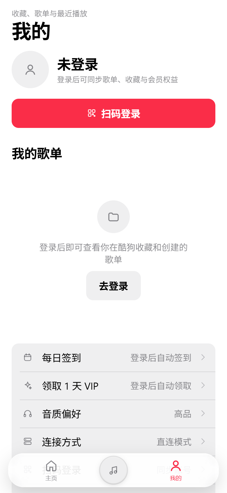
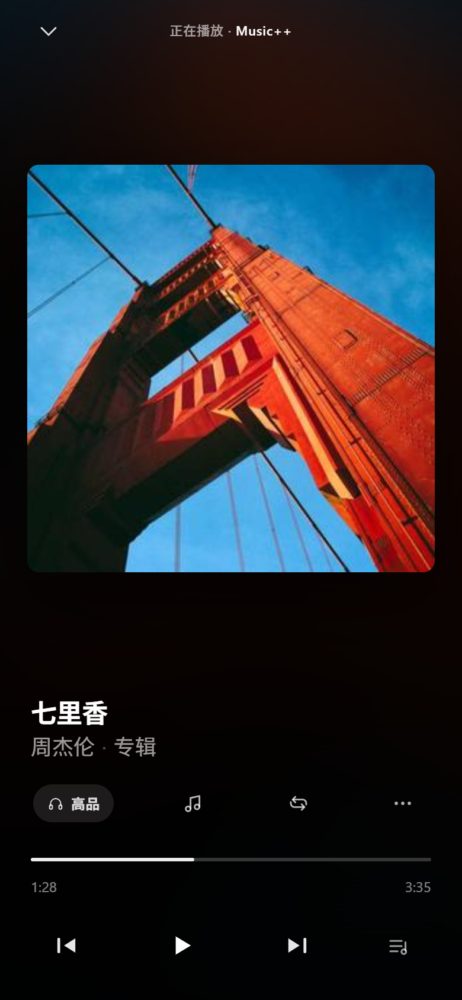
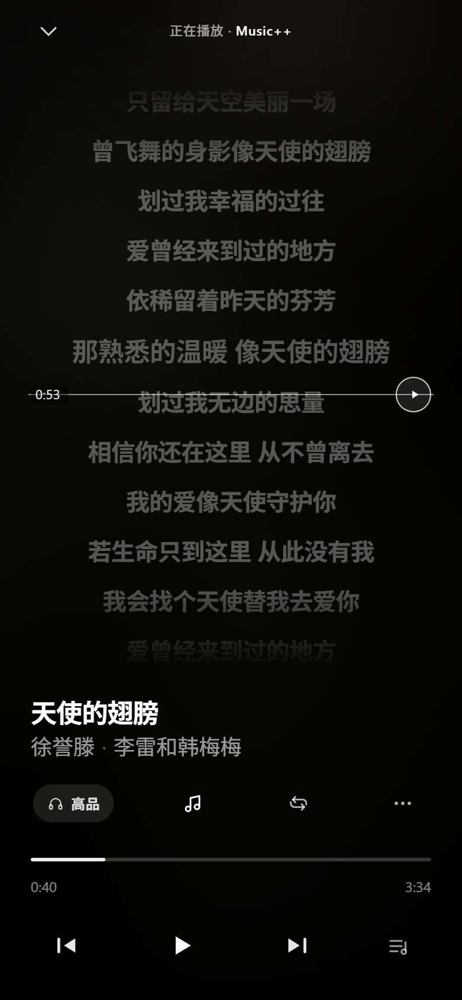
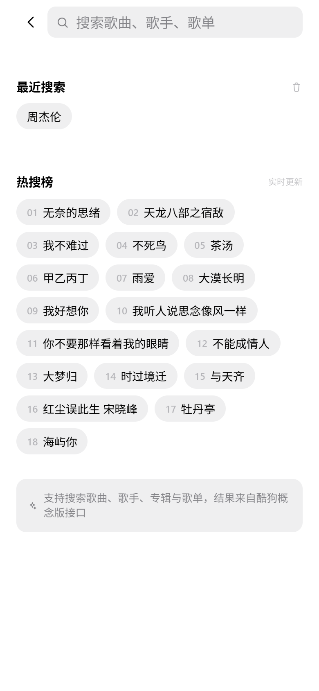
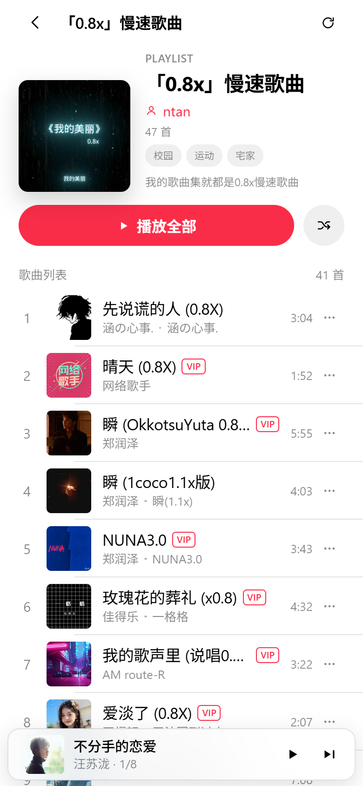
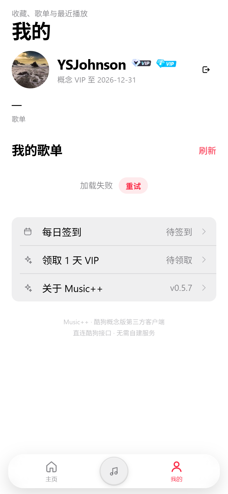
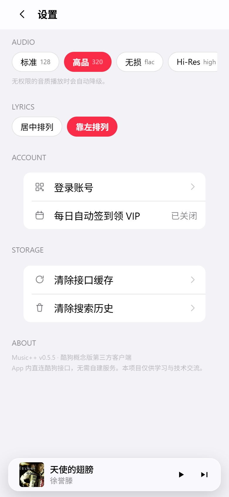
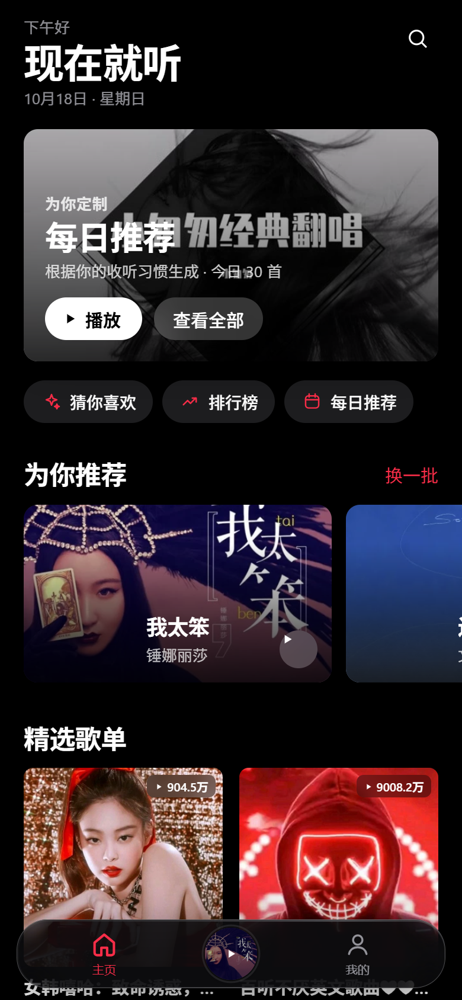
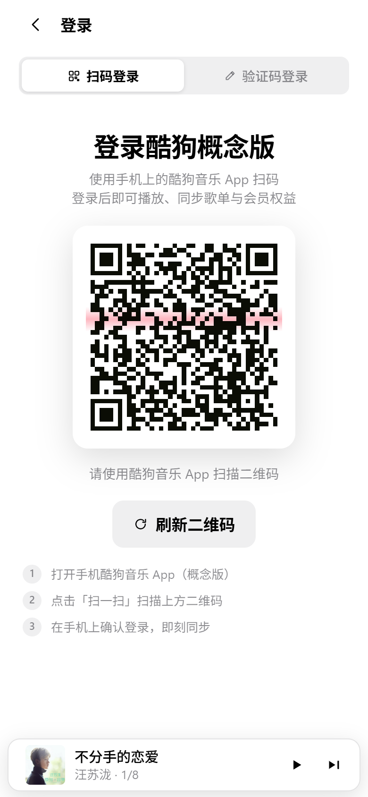
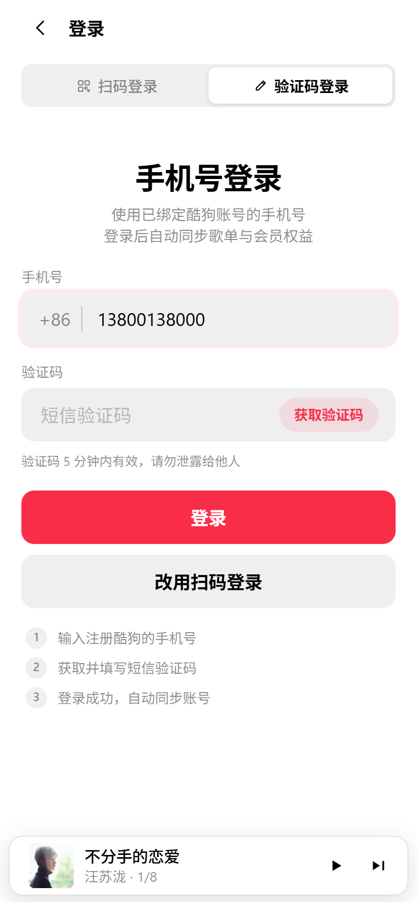

# Music++ · 酷狗概念版第三方客户端

> Music++（App 名：**MusicPP**）是一款开箱即用的酷狗概念版（lite）第三方客户端。
> **直连酷狗接口，无需电脑、无需自建服务器。**
> 界面参考 **Apple Music** 的信息层级与材质语言：大标题、分组列表、封面主导、红色点缀，明暗主题自动跟随系统。



## 特性

- **界面**：Apple Music 风格 —— 34pt 大标题、22pt 分区标题、iOS 分组列表、半透明底栏与迷你播放器，浅色/深色自动适配
- **玻璃底栏**：底栏采用开源库 [liquid-glass-react](https://github.com/rdev/liquid-glass-react)（MIT）的液态玻璃实现，带边缘折射、光斑高光与背景模糊；播放器封面居中，排版参考酷狗概念版
- **页面缓存**：播放器以覆盖层打开，返回时页面不重新请求、滚动位置保留；数据带 5 分钟缓存
- **转场动画**：播放器自下而上滑入，关闭时原路滑回（Android 返回键同样生效）
- **断点续听**：重启 App 后底栏中间的封面与进度条会恢复上次的歌曲和播放位置，点一下直接续播
- **纯直连**：不再提供服务器地址等连接设置，装好即用
- **导航**：底栏为「主页 / 正在播放 / 我的」三栏布局——中间圆形封面显示当前歌曲与播放进度环，点击进入播放器；搜索放到首页右上角
- **开箱即用**：安装即进入首页，默认直连酷狗，无需任何服务端配置
- **首页**：每日推荐（编辑精选大卡）、为你推荐、精选歌单、排行榜、新歌速递；右上角直达搜索
- **搜索**：从首页右上角进入，热搜、搜索历史、单曲 / 歌单 / 歌手 / 专辑四类结果、分页加载
- **播放器**：KRC 逐字歌词（上下拖动选进度，点指示条上的播放按钮才跳转，2 秒无操作自动回到当前进度；歌词可居中/靠左）、进度拖拽、播放队列；音质 / 歌词 / 播放模式 / 更多集中在歌曲信息下方、进度条上方的工具行（参考酷狗概念版）
- **后台播放**：切后台 / 锁屏继续播放（原生前台服务 + 唤醒锁保活）
- **账号**：扫码登录 / 手机验证码登录，登录后展示头像、昵称，以及酷狗原版「概念 VIP / 畅听 VIP」徽标，并同步歌单
- **每日自动签到**：登录后每天首次打开 App 自动完成两个领取动作 ——
  - 「每日签到」领取畅听 VIP 时长（`/youth/v1/recharge/receive_vip_listen_song`）
  - 「领取 1 天 VIP」升级概念版 VIP（`/youth/v1/listen_song/upgrade_vip_reward`）
  也可在「我的」手动补领，设置里可关闭自动执行

## 截图

| 首页 | 播放器 | 逐字歌词 | 搜索 |
| --- | --- | --- | --- |
|  |  |  |  |

| 歌单 | 我的 | 设置 | 深色模式 |
| --- | --- | --- | --- |
|  |  |  |  |

| 深色模式 | 扫码登录 | 验证码登录 |
| --- | --- | --- |
|  |  |  |

## 安装包（APK）

| 文件 | 说明 |
| --- | --- |
| `release/MusicPP-v0.5.8.apk` | 正式签名包（推荐，约 3.0 MB） |
| `release/MusicPP-v0.5.8-debug.apk` | Debug 包（排查问题用） |

- 包名 `com.musicpp.app`，应用名 **MusicPP**，最低 Android 6.0（API 23）
- 签名信息见 `android/keystore.properties`（仅本地保留，已加入 .gitignore）
- 重新打包：`powershell -ExecutionPolicy Bypass -File scripts/build-apk.ps1`

**使用流程**：安装 → 打开（直接进入首页）→「我的」登录（扫码 或 手机验证码）→ 听歌。

## 设计说明

参考 Apple Music / iOS HIG 重构了整套视觉：

- **字体层级**：大标题 34 / 分区标题 22 / 正文 17 / 说明 13 / 脚注 11，大字号负字距（`-0.021em`）
- **色板**：系统背景 `#FFF` / `#000`、半透明分隔线、三级文本灰阶；点缀色取 Apple Music 红 `#FA2D48`
- **组件**：编辑精选大卡（封面 + 渐变遮罩 + 白色文字）、横滑卡片、iOS 分组列表、Segmented Control、半透明 TabBar 与悬浮迷你播放器
- **材质**：底栏使用 liquid-glass-react（边缘折射 + 高光）；迷你播放器 / 抽屉 / Toast 使用 `backdrop-filter` 毛玻璃，其余保持纯色
- **深浅色**：`prefers-color-scheme` 自动切换；Android 原生启动图/状态栏通过 `values-night` 同步

## 实现原理

App 内实现了与 [KuGouMusicApi](https://github.com/MakcRe/KuGouMusicApi) 等价的客户端逻辑：

```
src/direct/
  sign.ts       请求签名（MD5 盐值 / signKey / signParamsKey）
  crypto.ts     登录加密（AES-256-CBC + 原始 RSA，与官方实现逐字节一致）
  device.ts     设备标识（GUID / MID / dfid，本地持久化）
  http.ts       请求组装 + 签名 + 原生 HTTP（CapacitorHttp 绕过浏览器 CORS）
  endpoints.ts  首页 / 搜索 / 歌单 / 专辑 / 歌手 / 榜单 / 歌词 / 播放地址
  login.ts      扫码登录 & 手机验证码登录（RSA 加密）
  krc.ts        KRC 逐字歌词解密（XOR + zlib）
```

- 直连模式固定使用概念版参数：`appid=3116`、`clientver=11440`
- 登录支持：扫码（酷狗 App 扫一扫）、手机验证码（发码 → AES/RSA 加密登录）
- App 只使用直连模式，不依赖任何自建服务

## 本地开发

```powershell
npm install
npm run dev          # 浏览器调试 http://127.0.0.1:5173
```

> 浏览器受 CORS 限制无法直连酷狗；开发时可先用 `scripts/start-api.ps1` 起一个
> KuGouMusicApi（dev 模式默认连 `http://127.0.0.1:3000`），或直接装 APK 真机调试。

打包：

```powershell
powershell -ExecutionPolicy Bypass -File scripts/build-apk.ps1
# 产物：release/MusicPP-v0.5.8.apk
```

## 目录结构

```
src/
  api/          接口出口（直连 / 服务端双模式）与数据归一化
  direct/       直连酷狗的实现（签名、加密、设备、请求、接口、歌词解码）
  components/   设计系统组件（TabBar、MiniPlayer、歌词、卡片、Sheet 等）
  pages/        页面（主页 / 我的 / 搜索 / 播放器 / 详情 / 登录 / 设置）
  store/        Zustand 状态（播放器 / 设置 / 账号）
  styles/       设计令牌与样式（base / shell / pages / player）
scripts/        截图、图标/启动图生成、直连联调、APK 构建脚本
android/        Capacitor 生成的 Android 工程
```

## 已知限制

- 酷狗对播放地址有风控：**未登录**时 `/song/url` 返回 `20028 本次请求需要验证`，登录后才能播放
- 直连模式下个人资料只显示基础信息（昵称需要 RSA 加密接口，暂未移植）
- 音频在 WebView 中播放，锁屏 / 切后台时可能被系统暂停
- 部分接口单页上限较低（如专辑 50 首/页），已做自动翻页

## 排障

**播放提示「需要登录后才能继续」**

在「我的 → 登录」选择扫码或手机验证码登录，登录后重新点播放即可。

**二维码过期 / 刷新无反应**

二维码约 2 分钟过期，过期后点「刷新二维码」；若网络异常，检查手机能否正常访问酷狗。

## 免责声明

本项目仅供学习与交流使用，不提供任何音乐内容。所有音乐、封面、歌词版权归酷狗音乐及对应版权方所有。
请勿用于商业用途，使用本项目产生的任何后果由使用者自行承担。
